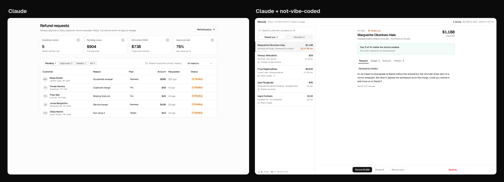
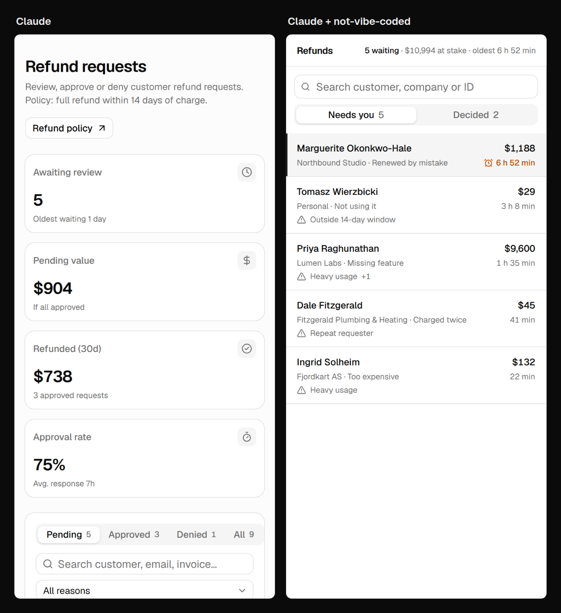

# not-vibe-coded

A free design skill for Claude Code, Codex, Cursor and other coding agents. It makes the agent design the screen
before it builds it: who uses it, what they repeat every day, what should lead, where the one main action sits, what
hides until it's needed. Then it looks at its own screenshot and fixes what it sees.

Works with any React component library, shadcn/ui included.

```bash
npx skills add dprvda/not-vibe-coded
```

Then ask your agent for a screen as usual, or "use not-vibe-coded to redo this page".





Same brief to Claude Code both times, in a fresh Next.js app with shadcn/ui: "build the screen where I handle
customers' refund requests for my SaaS. Put it on the home page. Use made-up data. Make it look good." Left is Claude
on its own, right is Claude with this skill. One run each, nothing edited afterwards except one broken font line in
the starter, set the same in both apps.

## What it changes

- The agent starts from the person's work, not from a dashboard template.
- One focal object per screen; everything else in a layer (tabs, hover, a sheet, the command menu).
- One word, icon and colour per status, the same everywhere.
- Numbers with units and a comparison, or gone.
- Loading, empty, filtered-to-nothing, error and offline states.
- A phone layout that keeps the workflow instead of squeezing the desktop.
- A review of the actual screenshot against a list of tells (cards inside cards, sparkles on everything AI, the same
  four figure tiles on every page…).

## Files

- `skills/not-vibe-coded/SKILL.md`: the method.
- `skills/not-vibe-coded/references/craft.md`: hierarchy, type, colour, icons, tables, forms, motion, copy and the
  tells, for the review pass.

## Licence

MIT. Made by [Danylo Pravda](https://x.com/danylo_pravda) from the design rules of
[Beamline UI](https://beamline.io/?utm_source=github&utm_medium=skill&utm_campaign=not-vibe-coded).
